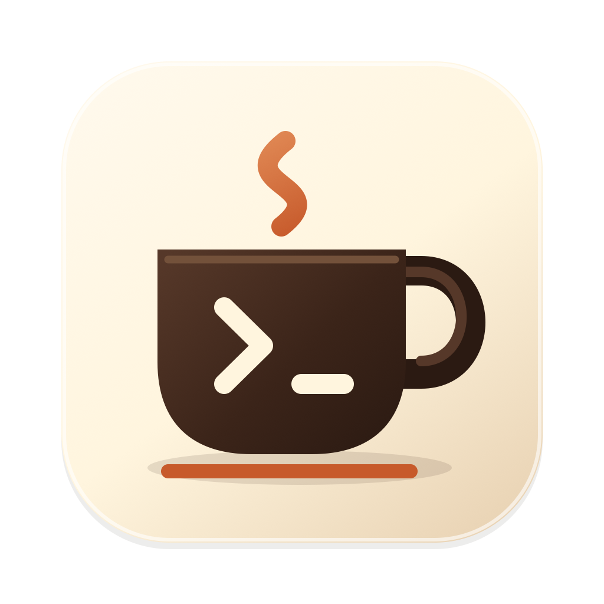
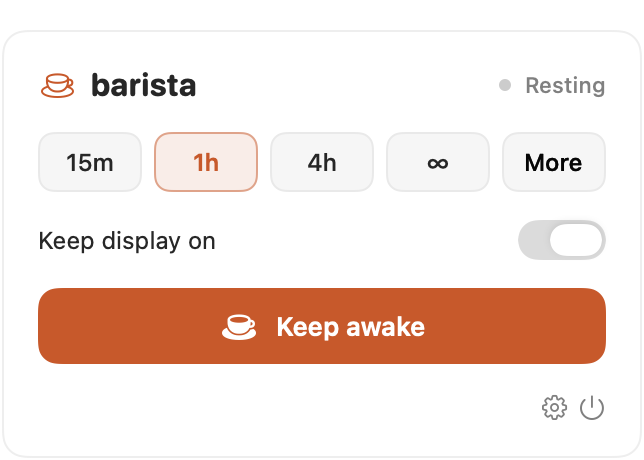
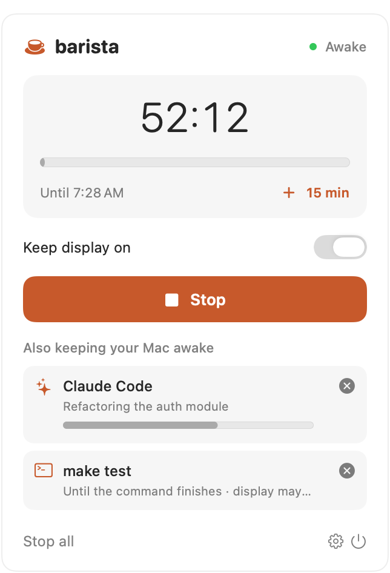

<p align="center"></p>

# Barista ☕

**Keeps your Mac awake while the work brews.** A free, open-source Mac menu-bar app for people, commands, and AI agents. Also on [Windows and Linux](#windows-and-linux). [Website](https://baristatime.app/) · [What’s new](CHANGELOG.md)

Keep your Mac awake for a timer, until an app quits, or while a command or agent is actually working. Independent tasks share one power assertion; one task finishing never ends somebody else’s session.

<p align="center">
  <picture>
    <source media="(prefers-color-scheme: dark)" srcset="site/assets/screenshots/menubar-active-dark.png">
    
  </picture>
</p>
<p align="center">
  <picture>
    <source media="(prefers-color-scheme: dark)" srcset="site/assets/screenshots/panel-idle-dark.png">
    
  </picture>
  <picture>
    <source media="(prefers-color-scheme: dark)" srcset="site/assets/screenshots/panel-active-dark.png">
    
  </picture>
</p>

## What’s included

- A coffee-cup menu-bar control with one simple panel: pick 15m, 1h, 4h, or ∞ and press **Keep awake**. **More** has custom minutes, an end time, and “while an app runs.”
- **Right-click** the cup for one-click timers. **Option-click** toggles your last session.
- **One-click Claude Code, ChatGPT Codex, and Cursor support:** Settings → Agents → **Connect**. Your Mac stays awake while the agent works and can sleep once it finishes. No MCP setup needed. (Codex asks you to trust the hooks once with `/hooks`.)
- **Cowork and the ChatGPT app:** these apps have no hooks, so Barista keeps your computer awake while they’re busy (judged by their CPU use, including Cowork’s VM) and lets it sleep once they’ve been quiet for 5 minutes. Switch each off in Settings → Agents.
- **Usage & Limits:** one window (panel, right-click menu, or Settings) with your Claude plan’s 5-hour and weekly limits, your ChatGPT plan’s limits and credits, and token usage per agent. Claude’s limits come from a small status line Barista adds to Claude Code (it keeps your own if you have one); ChatGPT’s from Codex’s logs. Cursor doesn’t share its limits with other apps.
- **Usage tracking:** sessions and tokens per agent and model for today, this week, and this month, with an estimated API-price cost, in Settings → Usage, the panel footer, `barista usage`, and the `barista_usage` MCP tool. Read from Claude Code’s and Codex’s own logs on your Mac; Cursor reports turns and active time through its hooks. Nothing is uploaded. Costs are estimates at API list prices, not what your subscription charges. Details: [docs/USAGE.md](docs/USAGE.md).
- **Projects and the usage report:** active time, sessions, tokens, models, and estimated cost per project (grouped by Git repository, so worktrees count with their main checkout), in Usage & Limits and `barista usage --period week`. **Projects** and **History** (tabs in Usage & Limits on a Mac, a window from the panel on Windows) show time per project, time per day, and every project's agents and models, updating live. Select a day to see just that day, right-click a number to copy it, show a project's folder, and export a CSV, web page, PDF, or (Mac) image. A 7-day chart in the menu-bar popover or panel opens History, and a Monday notification sums up last week. `barista report` (and Linux) opens the same report in your browser. Nothing is uploaded.
- Tasks that keep the Mac awake (agents, commands, watched apps) appear in the panel with live progress and individual stop buttons, and in the right-click menu. The menu bar shows your own timer’s time left, or how many tasks are running. Settings shows the last sessions.
- **Task-owned sessions:** commands renew their own short leases and release them on exit. Agents heartbeat during work and release when done. A missing heartbeat or watched process exit ends the session automatically.
- **Schedule:** keep your Mac awake during set hours, such as weekdays 8–5, by the system clock (Settings → Schedule).
- Separate display control. Agent/command sessions allow the display to sleep by default.
- Battery protection: stops awake sessions at 20% while on battery by default, with a configurable cutoff. Your actual work continues; awake sessions do not restart automatically.
- Launch at login, configurable global shortcut, Option-click quick toggle, optional completion notifications, and saved preferences.
- A bundled CLI and stdio MCP server. No third-party runtime, API key, cloud account, simulated input, or network listener.
- One-click updates: once a day Barista checks GitHub for a newer release. Click **Update** in the panel and it downloads it, verifies its signature, replaces itself, and relaunches. Running sessions carry over to the new version. Turn checks off or check now in Settings → Updates.

## Install

[Download Barista.dmg](https://github.com/cb-117/barista/releases/latest/download/Barista.dmg), open it, and drag **Barista** into Applications. Builds aren’t notarized yet, so the first time you open it macOS says it can’t verify Barista: click **Done**, then go to System Settings → Privacy & Security and click **Open Anyway**. You only do this once.

Or install from Terminal, which also connects Claude Code and Codex for you. AI agents can run it too (see [llms.txt](https://baristatime.app/llms.txt)); it skips the “Open Anyway” step because the download isn’t marked as coming from a browser:

```sh
curl -fsSL https://baristatime.app/install.sh | sh
```

The script installs the latest release to Applications after checking it against the release’s SHA-256, then runs `barista setup`. Already installed? Run `barista setup` (inside `Barista.app/Contents/Helpers/`) to connect any agents you’ve added since.

After that, Barista updates itself: when a new version is out, click **Update** in its panel and it installs and relaunches.

## Windows and Linux

Barista also runs on Windows 10/11 and Linux (x86_64 and arm64), built in Rust from [`rust/`](rust/README.md). It's the same Barista: a coffee cup in the notification area (Windows) or system tray (Linux) with quick timers, your tasks, Stop all, battery protection, launch at login, and notifications, plus the same `barista` CLI, `barista run`, MCP server, and one-click Claude Code and Codex hooks. Agents and scripts work the same on every platform.

Windows: download **Barista-Setup.exe** from the [latest release](https://github.com/cb-117/barista/releases/latest) (it asks whether to install for just you or for everyone on the PC), or in PowerShell (no administrator rights needed):

```powershell
irm https://baristatime.app/install.ps1 | iex
```

Linux:

```sh
curl -fsSL https://baristatime.app/install.sh | sh
```

Both check the download against the release’s SHA-256, install `barista` and `barista-app` (Windows: `%LOCALAPPDATA%\Programs\Barista`, added to your PATH and Start menu; Linux: `~/.local/bin`, plus an app-menu entry), and run `barista setup`. Re-run to update; Barista’s menu tells you when a new version is out. Or download `barista-<version>-windows-x86_64.zip` or `barista-<version>-linux-<arch>.tar.gz` from the [latest release](https://github.com/cb-117/barista/releases/latest).

On Linux the tray icon is a StatusNotifierItem (no GTK needed), shown by KDE Plasma, Ubuntu, Xfce, and most desktops; on stock GNOME install the AppIndicator extension, and on trays that only support XEmbed (i3bar, dwm, tint2) run `snixembed`. Left-click or right-click the cup for the menu; the time left appears in the icon’s tooltip. Without a graphical session (a server, WSL, SSH), `barista-app` runs headless and the CLI, hooks, and MCP keep working. Linux keeps the computer awake through the desktop’s power service (GNOME, KDE, and others) and a systemd-logind idle inhibitor; Windows uses a system power request (it shows in `powercfg /requests`).

What’s different from the Mac app: on Windows, clicking the cup opens a panel much like the Mac’s; on Linux it opens a menu. Neither has an end-time picker or “while an app runs” (use `barista start --pid` for that) or a global shortcut, and updates download from the release page instead of installing in place.

## Build and run

Requires macOS 13+ and Swift 6 command-line tools. No package dependencies.

```sh
zsh scripts/build-app.sh
open build/Barista.app
```

For a universal Intel + Apple Silicon bundle:

```sh
zsh scripts/build-app.sh --universal
```

Move `build/Barista.app` to Applications for everyday use. The app opens its panel on a normal launch; agent-triggered launches stay in the background. The power icon quits the app. **Stop** ends only your own timer; **Stop all** stops every awake session without terminating work.

Settings opens in its own window from the gear icon, the right-click menu, or ⌘, in the panel. The default shortcut is **Control–Option–Command–C**. Change it in Settings. The first time Barista runs from Applications, it adds itself to macOS Login Items. At login a tiny bundled helper opens it quietly in the menu bar. Turn this off in Settings → **Launch at login**; it stays off. macOS may ask you to approve it in System Settings → General → Login Items. Notifications request permission only when you enable them.

## Claude Code

Choose **Settings → Agents → Claude Code → Connect**, or run (the CLI is `/Applications/Barista.app/Contents/Helpers/barista`, or `build/barista` in a source checkout):

```sh
barista setup                   # connects Claude Code and Codex, whichever are set up
barista hooks install           # Claude Code only; also: status | uninstall
```

This adds Barista hooks to `~/.claude/settings.json` and leaves your other settings and hooks in place. A backup is saved next to the file as `settings.json.barista-backup`. Each conversation gets its own session: a prompt starts it, tool calls renew it, and it ends when Claude finishes its turn or exits. If Claude finishes while commands it started in the background are still running (shown as “Waiting” in Claude Code and T3), the session stays on until they exit. If you stop it in Barista, it stays stopped until your next prompt. If you move the app or a hook goes missing, Settings shows **Repair**.

## ChatGPT Codex

Choose **Settings → Agents → ChatGPT Codex → Connect**, or run `barista hooks install --agent codex` (or `barista setup`). This adds the same hooks to `~/.codex/hooks.json`, used by Codex in the ChatGPT app and the Codex CLI.

Codex asks you to approve new hooks once: type `/hooks` in Codex and trust Barista’s hooks. After that, each Codex task keeps your Mac awake while it works, shown as “Codex · <folder>”.

## Cursor

Choose **Settings → Agents → Cursor → Connect**, or run `barista hooks install --agent cursor` (or `barista setup`). This adds hooks to `~/.cursor/hooks.json`: a prompt starts a session, tool calls and replies renew it, and it ends when the agent stops. Cursor reloads hooks on its own. Each turn is also recorded for usage tracking (time and model, no prompts or code). Cursor doesn’t write token counts to disk, so Barista shows Cursor turns and active time rather than tokens; Cursor’s token and cost data is only available to Enterprise team admins through Cursor’s Admin API. Cursor documents hooks for its editor; its command-line agent may not run them.

## Use from a terminal or agent

```sh
# Automatically keep awake for exactly the lifetime of a command.
build/barista run --name "Build and test" -- make test

# Acquire an independent session; prints its ID.
build/barista start --name "Research agent" --minutes 5

# Renew and publish progress. Replace SESSION_ID with the returned ID.
build/barista heartbeat SESSION_ID --ttl 300 --progress 0.5 --message "Checking sources"
build/barista stop SESSION_ID
build/barista status --json

# Tokens and estimated cost per agent: today, this week, this month (or --period all).
build/barista usage
build/barista usage --period week --json
build/barista report
```

See [the agent guide](docs/AGENTS.md) for MCP setup, all commands, ownership rules, JSON responses, hard limits, and sandbox considerations. Settings also has **Copy CLI path** and **Copy MCP setup**.

## Releasing

The version lives in one place: `Sources/BaristaCore/Version.swift`. `scripts/build-app.sh` stamps it into the app, and `barista version` prints it.

1. Bump `BaristaVersion.current` (for example `0.0.1` → `0.0.2`).
2. In [`CHANGELOG.md`](CHANGELOG.md), rename **Unreleased** to `## [0.0.2] - YYYY-MM-DD` and start a new empty **Unreleased** section above it. CI fails, and nothing is released, until the new version has an entry.
3. Commit and push to `main`.

The **Release** workflow notices the new version, runs the checks, builds a universal app, and publishes `v0.0.2` on GitHub Releases. The release notes are that version’s `CHANGELOG.md` entry, followed by install instructions. The release includes:

- `Barista-<version>.dmg` and `Barista.dmg` (the same disk image; the website links to the stable name)
- `Barista-<version>.zip` and `Barista-<version>.zip.sig`, which the in-app updater uses
- `barista-<version>-windows-x86_64.zip`, `barista-<version>-linux-x86_64.tar.gz`, and `barista-<version>-linux-arm64.tar.gz`, built from `rust/` (which reads the same version), plus copies without the version for `install.sh` and `install.ps1`
- `SHA256SUMS.txt`

The app installs an update only if the zip is signed with the release key. The private key is the `BARISTA_UPDATE_KEY` Actions secret (a backup is in the maintainer’s Keychain as “Barista update signing key”), and the public key is `UpdateSignature.publicKey` in `Sources/BaristaCore/UpdateCheck.swift`. The workflow refuses to publish if they don’t match. To package a disk image locally: `pip install dmgbuild==1.6.5`, then `zsh scripts/make-dmg.sh`. Pushes that don’t change the version don’t create a release. Running apps see the update within a day, or right away from Settings → Updates → **Check now**.

Every push to `main` also attaches a universal `Barista.zip` to its **CI** run (kept for 30 days), so you can try any commit without releasing it.

## Limits and privacy

This prevents **idle sleep**. It does not override closing a laptop lid, choosing Sleep, shutdown, or a depleted battery. Timers use wall-clock deadlines, so manual sleep does not pause them. Watched-app sessions last exactly as long as the app runs (no time cap) and track process lifetime, not whether the app is doing useful work. Use the command runner or agent heartbeats for precise job lifetimes.

Agent leases default to five minutes and an eight-hour hard cap. Commands renew a 45-second lease every ten seconds, tied to the runner’s PID and process start time. TTL and hard limits cannot exceed 24 hours. An explicit Stop or battery cutoff cannot be reversed by a heartbeat. Never reacquire automatically to override a user’s Stop.

Sessions are visible and controllable in the app. The local control socket is restricted to your user account; no TCP port is opened. History stores only the last 20 task names, start/end times, and completion reasons in local preferences. Command arguments/output are not recorded. Active sessions are never restored after an app restart. You can clear history or disable agent access in Settings.

To show your Claude plan’s limits, the Barista app asks Anthropic for them at most every 5 minutes, using Claude Code’s saved login (read-only: Barista never refreshes, stores, or logs it). On macOS, Barista reads the login with Apple’s `security` tool, the way Claude Code does, so macOS doesn’t ask for Keychain access. Turn this off in Settings → Agents. Apart from that, the only network requests Barista makes are for updates: an anonymous HTTPS request to GitHub’s public releases API at most once a day, and downloading an update when you click **Update**. They send no identifiers, usage, or session data. Turn automatic checks off in Settings → Updates.

The build is ad-hoc signed for local use, and release builds aren’t notarized yet. After the first launch, allow the app in System Settings → Privacy & Security → **Open Anyway**, or install with `install.sh`, which skips that step. Intel binaries are cross-compiled; testing on an Intel Mac is recommended before a public release.

## Verify

```sh
swift build
swift run BaristaChecks --power
python3 Tests/agent_integration.py
```

For the Windows and Linux build (Rust 1.89+; no system libraries needed):

```sh
cd rust && cargo test --workspace && cargo build --workspace && cd ..
python3 Tests/agent_integration.py --bin-dir rust/target/debug --service rust/target/debug/barista-app
python3 Tests/portable_smoke.py --bin-dir rust/target/debug   # also runs on Windows
```

`BaristaChecks` covers session expiration, independent owners, display aggregation, heartbeat expiry/hard caps, process reuse, battery protection, custom input, history, and concurrent real Unix-socket requests. `--power` briefly creates real macOS sleep-prevention assertions and confirms cleanup. The Python suite uses an isolated service with fake power assertions to exercise the CLI, command runner, JSON output, MCP handshake/tools/errors, user stops, and crash recovery.

Run local-socket integration checks outside a network-restricted command sandbox; a sandbox can prohibit even private Unix sockets. These checks need no administrator privileges. To test a different binary directory, use `python3 Tests/agent_integration.py --bin-dir PATH`.

## License

MIT. See [LICENSE](LICENSE).
